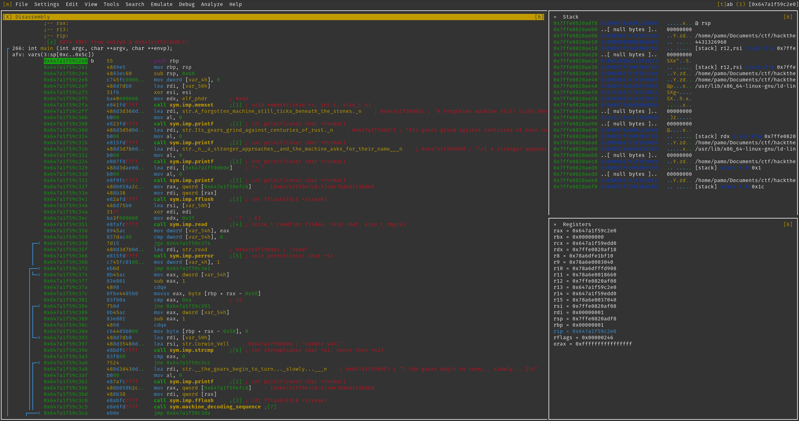
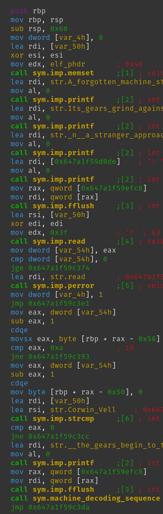
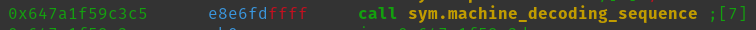
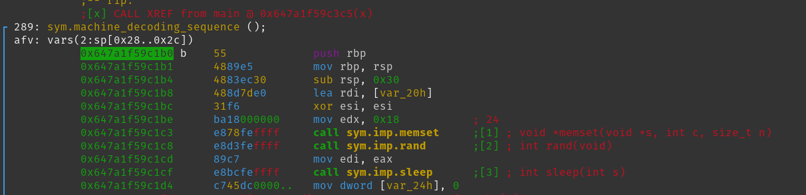
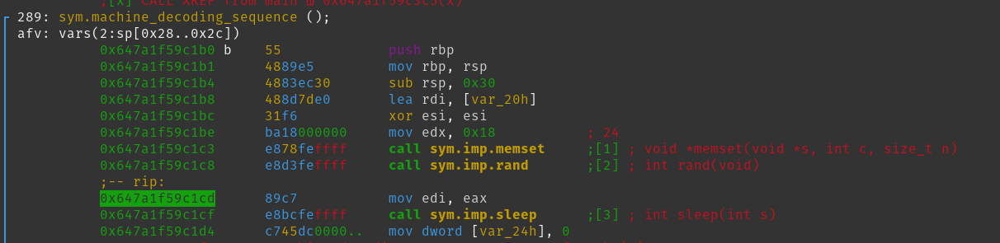
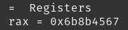
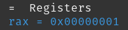
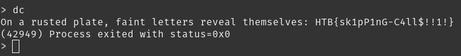

status: #pwnd 
ctf: #hacktheboo2025 
level: #easy 
type: #reversing 
challenge: the wax-circle reclaimed 
helper: #executable 

---

# static analysis 
- file command shows us that its an ELF executable 
- strings command on rusted_oracle give us some information about hard coded stings in the executable, some of them are following 
```
On a rusted plate, faint letters reveal themselves: %s 
A forgotten machine still ticks beneath the stones. 
Its gears grind against centuries of rust. 
[ a stranger approaches, and the machine asks for their name ] 
read Corwin Vell 
[ the gears begin to turn... slowly... ] 
[ the machine falls silent ]
```

# dynamic analysis  
executing the file gives us following output 
```
A forgotten machine still ticks beneath the stones. Its gears grind against centuries of rust. 

[ a stranger approaches, and the machine asks for their name ] 
> 
```

- we get asked to input a name. In the static analysis we found the name Corwin Vell 
- using that name in the input, outputs following 
```
[ the gears begin to turn... slowly... ] 
```

- but thats it, nothing happens, seems like we missed something. 

# radare2 
- for debugging we will use radare2, a command line tool 
```bash
radare2 -d ./rusted_oracle 
```

- now we will execute the following options 
```radare2
 # show help list 
 ? 
 
 # analyzes the binary 
 aaaa 
 
 # show us all the functions 
 afl 
 
 # sets a breakpoint at the main function 
 db sym.main 
 
 # show all our breakpoints 
 db 
 
 # continues execution until it hits a breakpoint or the binary is done executing 
 dc 
 
 # starts the panel mode 
 v 
 
 # opening the prompt to execute more commands 
 : 
```
 
 - Here is the panel mode, on the left the assembly code with some helpful comments from radare2, top right is our stack und bottom right the registry 



 - we will first focus on the assembly code. Currently the binary stopped at the top address `0x657a1f59c2e0` 
 - in the following screenshot you can see just the assembly code. The known functions are written out which is very helpful for us like `sym.imp.printf` or at the bottom the `sym.machine_decoding_sequence` which is in our case the function of interest 



 - lets set a breakpoint where the sym.machine_decoding_sequence function gets executed
 - we can either use the hexnumber `0x647a1f59c3c5` which sets the breakpoint where the functions gets called OR we can us the name `sym.machine_decoding_sequence` which sets the breakpoint at the start of the actual function 
 

 
 - we use the function name and continue the binary afterwards 
```radare2
 db sym.machine_decoding_sequence
 
 dc 
```

 - after writing Corwin Vell to the input the breakpoint hits 
 


 - now in the function we see only 3 more functions are being called 
```
 sym.imp.memset # can be ignored 
 
 sym.imp.rand # generates a random number 
 
 sym.imp.sleep # lets the binary sleep for some amount of time 
```
 
 -  lets continue our program till we are one line after the sym.imp.rand we can do that by pressing S which executes one line at a time 
 - now we are on the line with the assembly instruction `mov edi,eax` , this instruction moves the value in `eax` into `edi` which works as the register for the first parameter for the `sym.imp.sleep` function which expects one parameter int sleep(int s) 
 

 
 - looking at the registers what value is currently in the `eax` register we see its the value `0x6b8b4567` or in decimal `1804289383` which is a little high 
 


 - lets reduce this time, becauce we cant wait here forever, by changing the value of the `eax` (rax) register 
 
```
# sets the eax value to 1 
dr eax=0x1 
```



- we changed the value of the `eax` (rax) register 
- now lets continue execution 



- voila the sleep function only stopped the program for 1 second and we now have the flag